# CAOTITOS — Reporte final de la Unidad 2

**Materia:** Desarrollo Web

**Fecha:** 9 de octubre de 2026

**Proyecto:** CAOTITOS, catálogo web de productos para gatos

**Institución, alumno, matrícula y docente:** datos pendientes de proporcionar por el estudiante.

## Índice

1. Introducción y objetivos
2. Alcance y tecnologías
3. Diagnóstico inicial
4. Identidad y diseño
5. Estructura e imágenes
6. Implementación HTML
7. Implementación CSS y adaptación móvil
8. Implementación JavaScript
9. Pruebas y resultados
10. Evidencias
11. Ejecución, Git y despliegue
12. Optimización de imágenes
13. Limitaciones y mejoras futuras
14. Conclusiones y procedencia

## 1. Introducción y objetivos

CAOTITOS es un sitio académico de cuatro páginas que presenta productos para gatos. Su nombre juega con «caos» y «gatitos», en referencia a las travesuras de los gatos. El lema es **Pequeños gatos, grandes travesuras**.

El objetivo de esta entrega es integrar estructura semántica, estilos compartidos, adaptación a teléfonos y programación del DOM en una experiencia coherente. La revisión final también busca ordenar los recursos, corregir diferencias entre páginas y documentar resultados comprobables.

Los objetivos específicos son mantener el mismo encabezado y pie en las cuatro páginas, presentar un catálogo con búsqueda inmediata, validar un formulario demostrativo, organizar las imágenes por función y entregar evidencias del código y del sitio.

## 2. Alcance y tecnologías

| Tecnología | Aplicación |
|---|---|
| HTML5 | Cuatro documentos con navegación, contenido semántico, imágenes y formulario |
| CSS3 | Hoja compartida, Flexbox, Grid, estados de enfoque y media queries |
| JavaScript | Arreglo de productos, generación de tarjetas, búsqueda y respuesta del formulario |
| Git y GitHub | Historial y publicación del código en el repositorio independiente ARIOT117/CATSTORE |
| Python 3 | Servidor local y verificación reproducible de rutas y consistencia |

El sitio no necesita compilación, framework, instalación de paquetes ni servidor de aplicaciones. Es un **prototipo de catálogo**, no una tienda con cobros, carrito o autenticación real.

## 3. Diagnóstico inicial

Antes de editar se compararon los bloques completos de las cuatro páginas:

- Los encabezados eran equivalentes después de excluir el atributo que identifica la página activa y las diferencias de espacios.
- Había dos versiones del pie: Inicio apuntaba al perfil de Instagram `diego_at117`, mientras las otras páginas enlazaban a `ig.me/m/catstore`.
- El texto visible de Instagram tampoco coincidía con el perfil de Inicio.
- Las imágenes estaban repartidas entre nombres genéricos, nombres con espacios, `img-ramdom` y archivos sin uso.
- La imagen `cama.png` correspondía realmente al rascador Scratch & Play.
- El reporte anterior tenía fechas distintas, referencias a una imagen de diagrama inexistente, pruebas pendientes y menciones a tres páginas cuando hay cuatro.
- El formulario anunciaba un inicio de sesión exitoso aunque no verificaba credenciales.

Se igualaron los bloques compartidos y se conservó como contacto de Instagram el perfil ya utilizado en Inicio. El correo y teléfono existentes se mantuvieron: cambiar el nombre del proyecto no crea nuevas cuentas de contacto.

## 4. Identidad y diseño

La marca visible es **CAOTITOS** en los títulos del navegador, encabezados, pies, textos y mensajes del formulario. El logo existente se conserva. La marca funciona como enlace a Inicio y lleva una etiqueta accesible.

La paleta utiliza crema `#f8f0e6`, café `#86513f`, café oscuro `#49372e` y tonos durazno. Arial se usa en la interfaz y Georgia en títulos destacados. Las tarjetas tienen bordes redondeados, sombras suaves y estados de interacción.

Las imágenes tienen una función definida: gatos en presentaciones e ilustraciones; fotos del producto en sus tarjetas; iconos en contacto; patrón decorativo en el formulario. No se incorporan imágenes ajenas al catálogo como si fueran productos.

## 5. Estructura e imágenes

```text
CAOTITOS/                      copia independiente del repositorio CATSTORE
├── index.html                Inicio
├── productos.html            Catálogo y buscador
├── nosotros.html             Presentación, misión y visión
├── login.html                Formulario demostrativo
├── CSS/style.css             Estilos compartidos
├── JS/
│   ├── script.js             Catálogo
│   └── login.js              Respuesta del formulario
├── assets/img/
│   ├── marca/                Logo e indicador de página activa
│   ├── iconos/               Correo, WhatsApp e Instagram
│   ├── fondos/               Patrón del formulario
│   ├── gatos/                Cinco imágenes usadas en las páginas
│   ├── productos/            Tres fotografías del catálogo
│   ├── archivo/              Cinco recursos conservados sin uso actual
│   └── README.md             Criterio de organización y procedencia
├── docs/
│   ├── codigo/               Seis imágenes del código fuente
│   ├── capturas/             Evidencias del navegador
│   └── pruebas-navegador.json Resultados por página y ancho
├── scripts/verificar.py      Verificación local
├── LICENSE                   Derechos de uso del repositorio
├── README.md                 Guía rápida
└── REPORTE.md                Este reporte
```

El proyecto conserva **19 recursos gráficos**: 14 imágenes usadas por la web se redimensionaron y convirtieron a WebP; 5 recursos originales sin uso permanecen en `archivo/`. Los PNG anteriores se pueden recuperar del historial de Git. Las referencias HTML, CSS y JavaScript apuntan a la nueva ubicación.

| Carpeta | Cantidad | Ejemplos |
|---|---:|---|
| marca | 2 | `logo-gato.webp`, `gato-menu-activo.webp` |
| iconos | 3 | `correo.webp`, `whatsapp.webp`, `instagram.webp` |
| fondos | 1 | `patron-gatos.webp` |
| gatos | 5 | `gato-inicio.webp`, `gato-maxwell.webp`, `gato-catalogo.webp` |
| productos | 3 | `croquetas-pollo.webp`, `raton-travieso.webp`, `rascador-scratch-play.webp` |
| archivo | 5 | Fondos alternativos, gatos, ilustración y retrato sin uso |

El repositorio de publicación es CATSTORE y la marca visible es CAOTITOS. La copia independiente de trabajo se encuentra en `Escritorio/CAOTITOS`, con su propio directorio `.git` y el remoto correcto.

## 6. Implementación HTML

Cada página incluye `header`, `nav`, `main` y `footer`. Los cuatro encabezados son idénticos excepto `aria-current="page"`, que indica el enlace seleccionado. El pie es idéntico en contenido y enlaces.

Los bloques permanecen en HTML estático para que la navegación y el contacto funcionen sin JavaScript. Para evitar futuras diferencias, `scripts/verificar.py` compara los encabezados y pies de las cuatro páginas.

- **Inicio:** presentación, imagen principal, llamadas a la acción y beneficios.
- **Productos:** campo de búsqueda, contador accesible y contenedor de tarjetas.
- **Nosotros:** presentación, misión, visión y contacto.
- **Acceder:** cuatro campos con etiquetas asociadas y una respuesta accesible.

El catálogo usa `aria-live="polite"` para anunciar el número de resultados. Las imágenes informativas incluyen texto alternativo; las decorativas tienen alternativa vacía o un contenedor `aria-hidden`. Los enlaces externos que abren otra pestaña incluyen `rel="noopener noreferrer"`.

## 7. Implementación CSS y adaptación móvil

Flexbox organiza el encabezado y el pie; Grid organiza las tarjetas, la presentación y el formulario. `object-fit: contain` permite mostrar los productos sin recortar su contenido. Los contenedores se limitan con `min()` y los títulos usan `clamp()`.

### Mejora del encabezado en teléfono

En anchos de hasta 600 píxeles, el logo y la marca forman una fila compacta con el lema debajo del nombre. La navegación se organiza en una barra de cuatro columnas: Inicio, Productos, Nosotros y Acceder. Cada enlace tiene una altura mínima de 46 píxeles. La página activa se identifica mediante un fondo claro y el icono del gato. Se mantiene el foco visible para navegación con teclado.

Esta solución muestra todos los destinos sin requerir un menú desplegable ni JavaScript.

| Ancho máximo | Ajuste principal |
|---|---|
| 1250 px | Tamaño de ilustraciones del formulario |
| 1000 px | Encabezado apilado y pie en columna |
| 950 px | Ilustraciones del formulario en la parte inferior |
| 900 px | Reorganización del buscador y sus ilustraciones |
| 800 px | Presentación principal en una columna |
| 600 px | Nueva barra compacta de navegación móvil |
| 480 px | Espaciado y tamaños de tarjetas y contenido |

## 8. Implementación JavaScript

### 8.1 Datos y tarjetas

`JS/script.js` contiene tres objetos con identificador, nombre, descripción, precio, cantidad, imagen y categoría. `Intl.NumberFormat("es-MX", { style: "currency", currency: "MXN" })` presenta los precios en pesos mexicanos.

`tarjeta(p)` convierte cada objeto en un `article`. Incluye imagen con carga diferida, categoría, nombre, descripción, precio y existencias. Si falta una imagen, muestra un símbolo; si la cantidad es cero, muestra «Agotado».

`mostrarProductos(productos)` resuelve tres estados: catálogo vacío, búsqueda sin coincidencias y lista con resultados. Las tarjetas se insertan mediante `productos.map(tarjeta).join("")`.

El uso de `innerHTML` se limita a datos escritos en el código del proyecto. Si los productos provinieran de usuarios o servicios externos, sería necesario tratar esos datos como no confiables antes de insertarlos.

### 8.2 Buscador

El evento `input` toma el texto, elimina espacios exteriores y lo convierte a minúsculas. `filter()` busca coincidencias en nombre, identificador, categoría y descripción. Después actualiza tarjetas y contador. Borrar el texto vuelve a mostrar los tres productos.

La búsqueda no distingue mayúsculas, pero conserva la diferencia entre letras acentuadas y no acentuadas.

### 8.3 Formulario

Los campos nombres, apellido, correo y contraseña son obligatorios. `type="email"` valida el formato del correo; `type="password"` oculta lo escrito. El evento `submit` usa `preventDefault()` para evitar la navegación.

La respuesta se escribe mediante `textContent` en un elemento con `role="status"`. Incluye el nombre y aclara que no se ha creado una cuenta. Al terminar se vacía el campo de contraseña. No se envían datos a un servidor ni se guardan en almacenamiento local.

Se reemplazó la alerta de autenticación exitosa por una confirmación visible y precisa sobre el alcance demostrativo.

## 9. Pruebas y resultados

Se ejecutó el sitio con un servidor HTTP local y se revisó con el navegador de la aplicación. Las comprobaciones estáticas son reproducibles con Python; la sintaxis JavaScript se comprobó con Node.

| Prueba ejecutada | Resultado observado |
|---|---|
| Comparación de encabezados | Iguales salvo el atributo de página activa |
| Comparación de pies | Cuatro bloques idénticos |
| Enlace activo por documento | Exactamente uno y corresponde a la página |
| Rutas HTML, imágenes CSS y catálogo JS | Todos los archivos referenciados existen |
| Inventario de imágenes | 14 WebP en uso y 5 recursos archivados |
| Sintaxis de ambos archivos JS | Sin errores en `node --check` |
| Catálogo inicial | 3 productos |
| Buscar «ratón» | 1 producto |
| Buscar «zzz» | Aviso «No encontramos productos» |
| Borrar búsqueda | Vuelven los 3 productos |
| Formulario vacío | Campo nombres con `valueMissing: true` |
| Envío completo mediante Enter | Confirmación con «Ejemplo» y contraseña vacía |
| Cuatro páginas a 390 px | Sin desbordamiento horizontal |
| Cuatro páginas a 320 px | Sin desbordamiento horizontal |
| Cuatro páginas a 1280 px | Sin desbordamiento horizontal |
| Navegación a 320, 390 y 1280 px | Un enlace activo en cada página |
| Imágenes en revisión móvil tras cargar | Sin imágenes rotas |

Los resultados de anchura se conservan en [pruebas-navegador.json](docs/pruebas-navegador.json). Las imágenes del catálogo usan carga diferida: una imagen todavía no cargada fuera de pantalla no implica una ruta rota.

Las pruebas no verifican recepción real de correos, mensajes de WhatsApp ni propiedad de las cuentas de contacto. Tampoco constituyen una auditoría completa de accesibilidad o compatibilidad con todos los navegadores.

## 10. Evidencias

Las imágenes de código se generaron directamente a partir de los archivos finales con resaltado de sintaxis y números de línea; no son capturas de una ventana de VS Code. Las capturas de interfaz sí provienen del navegador.

### Código del encabezado
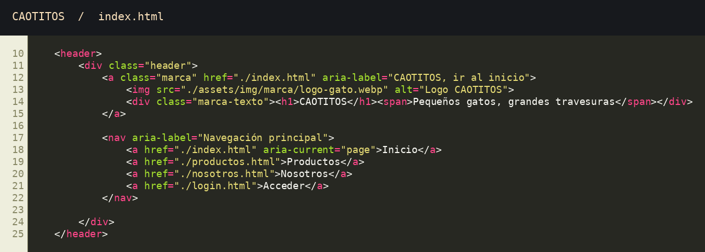

### Código del pie
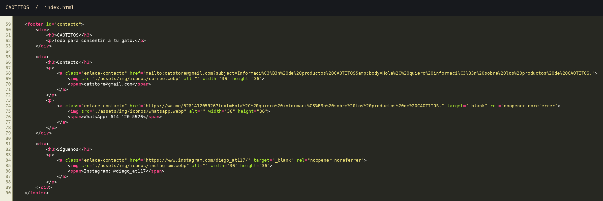

### Generación de tarjetas
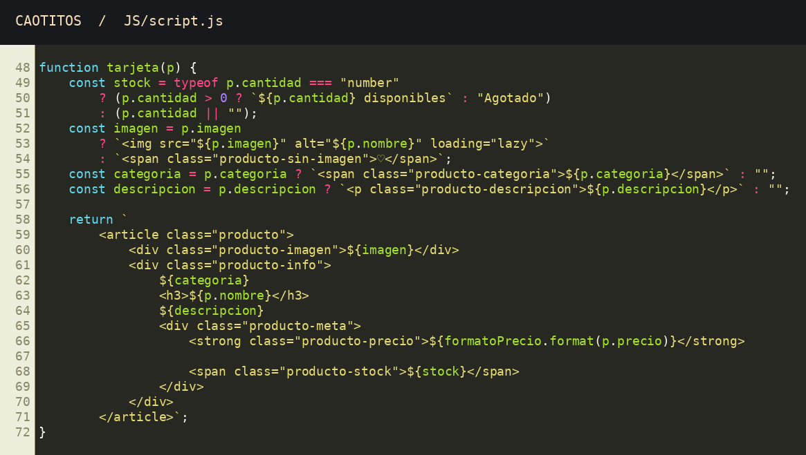

### Estados del catálogo y búsqueda
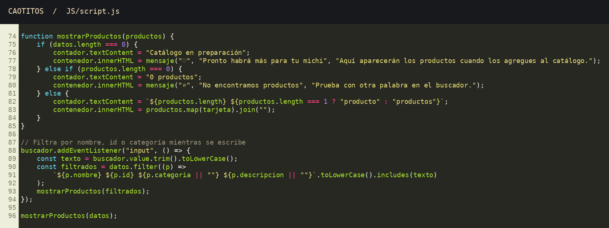

### Formulario demostrativo
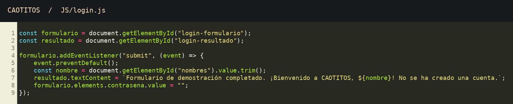

### Estilos de marca y encabezado móvil
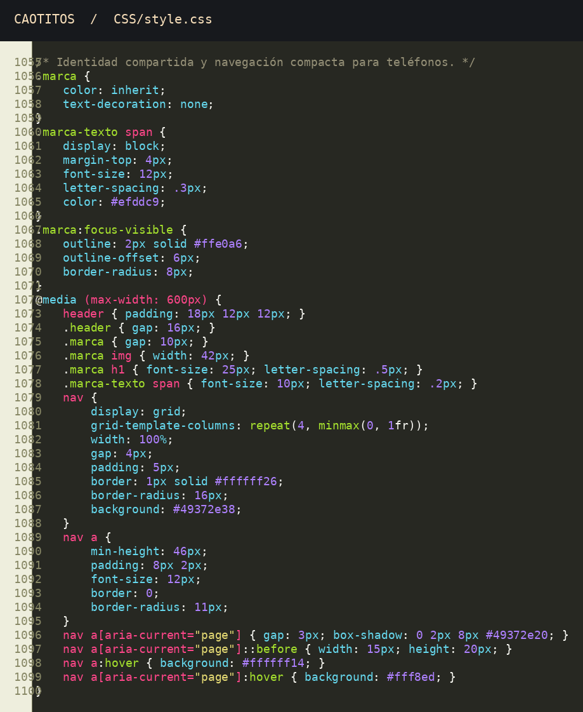

### Interfaz final y pruebas funcionales

Las siguientes 13 capturas se tomaron del sitio CAOTITOS en el navegador. Las vistas de escritorio usan un viewport de 1280 × 1000 y las móviles de 390 × 844. Algunas evidencias muestran una sección desplazada para hacer visible el resultado y el pie de página.

**1. Inicio en escritorio:** marca, navegación, presentación y beneficios.


**2. Nosotros:** identidad, misión, visión y contacto.
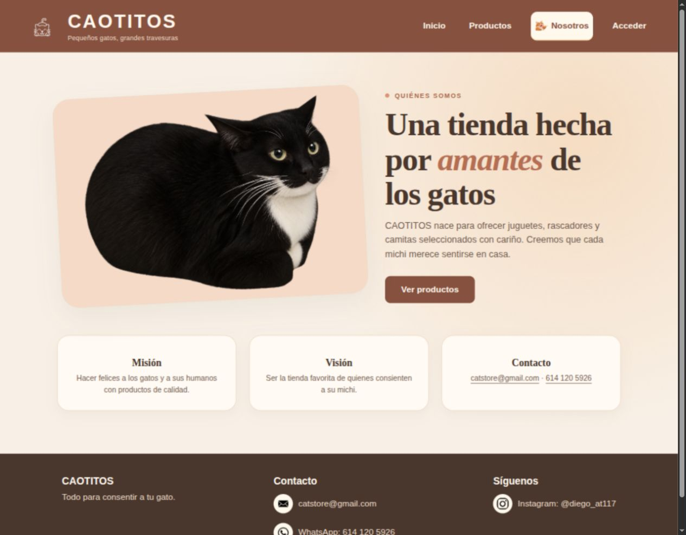

**3. Catálogo inicial:** buscador y contador de tres productos.
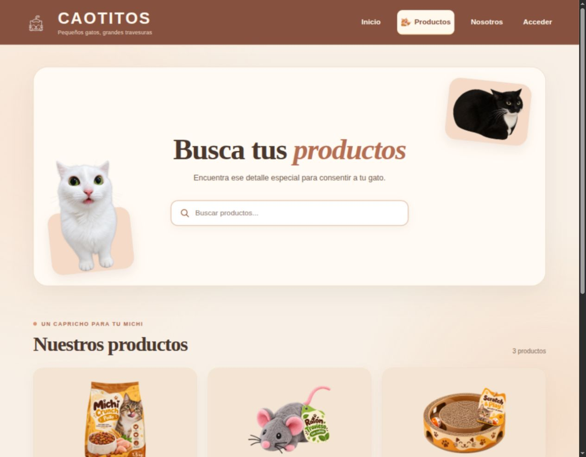

**4. Tarjetas y pie compartido:** fotografías, precios, existencias y contactos.
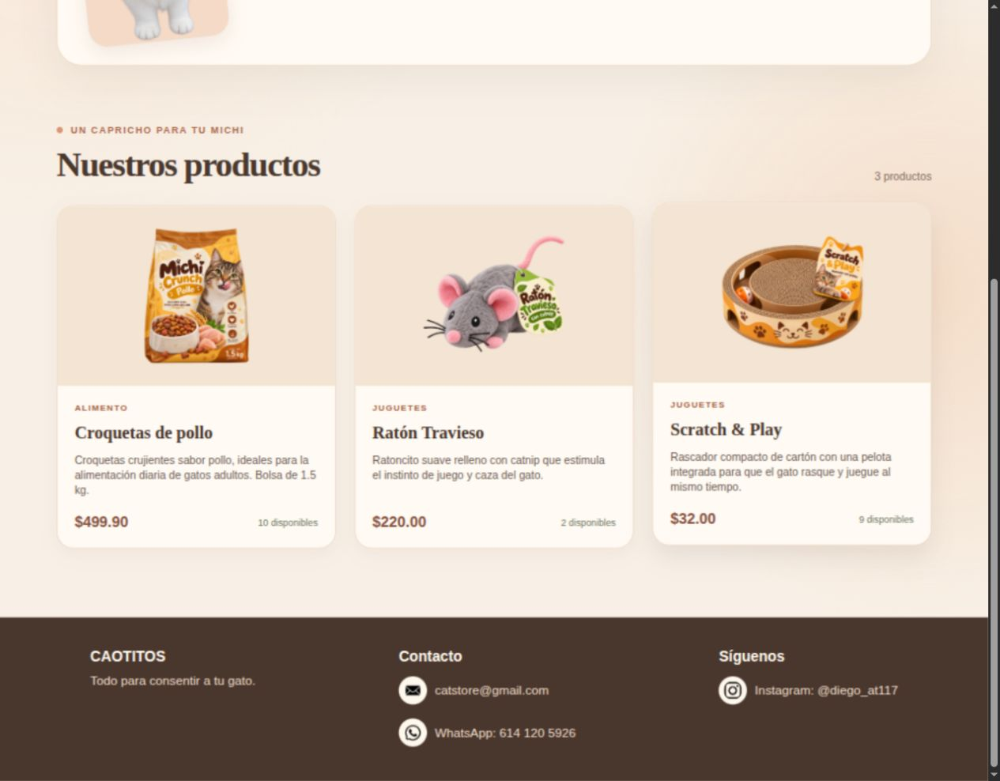

**5. Búsqueda «ratón»:** aparece únicamente Ratón Travieso.
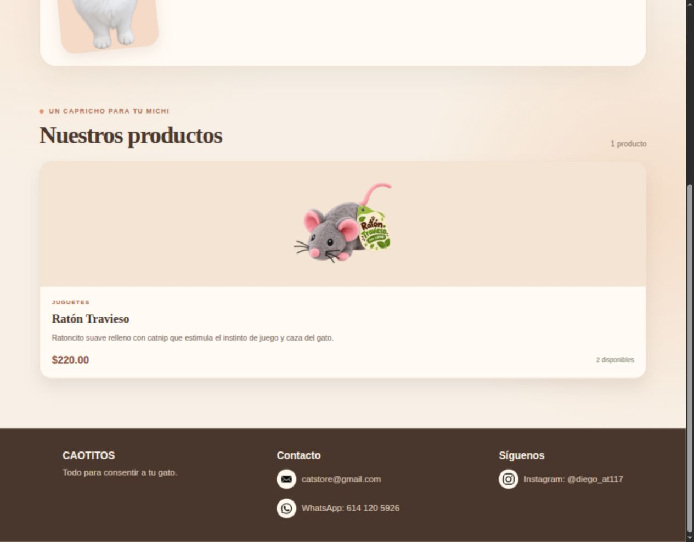

**6. Búsqueda «zzz»:** estado sin coincidencias.
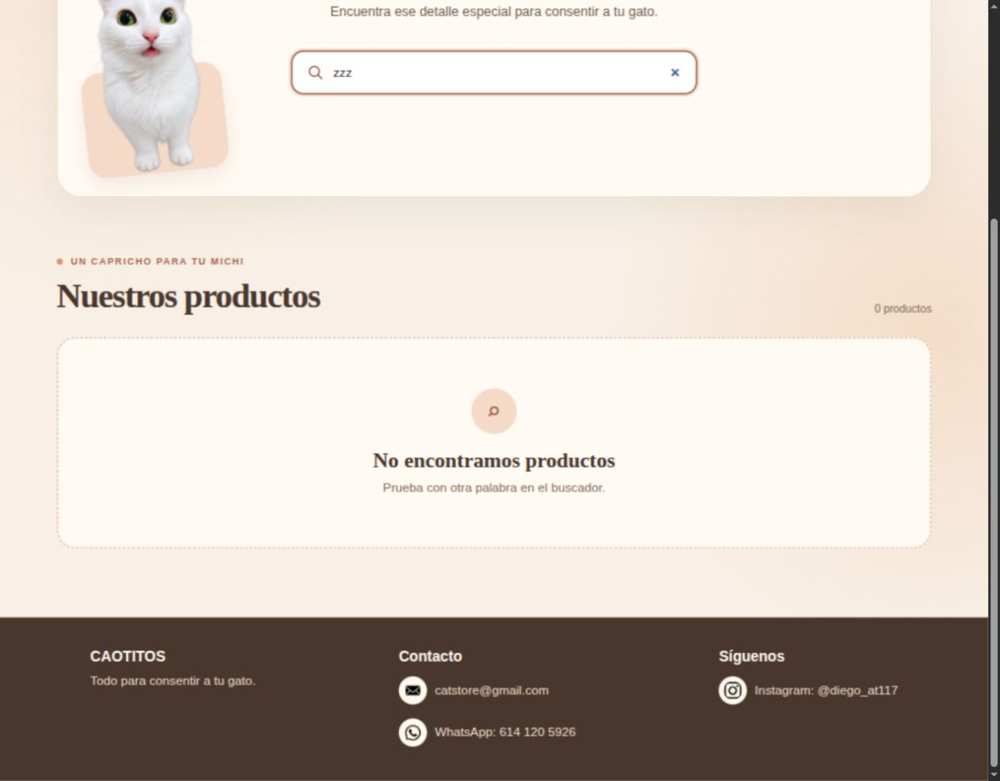

**7. Formulario vacío:** campos y aviso sobre el carácter demostrativo.
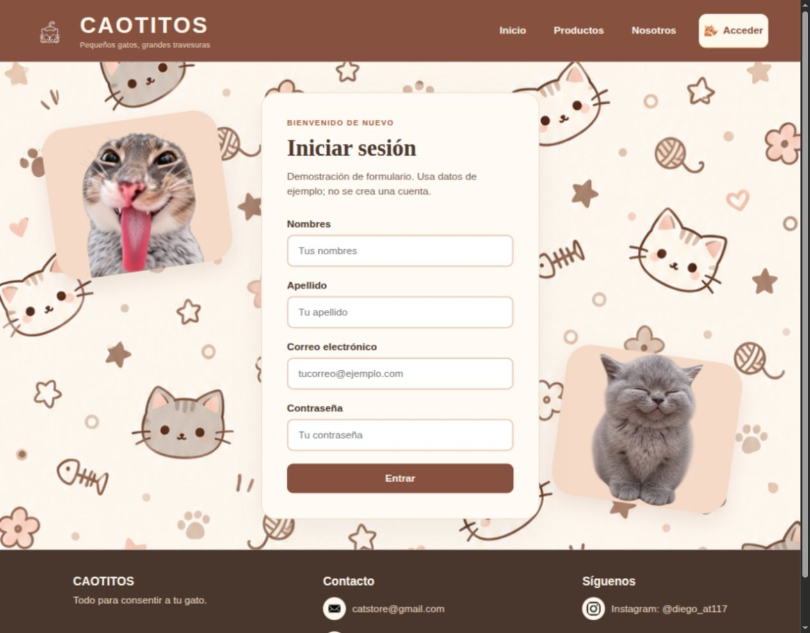

**8. Campo obligatorio:** validación nativa al intentar enviar sin datos.
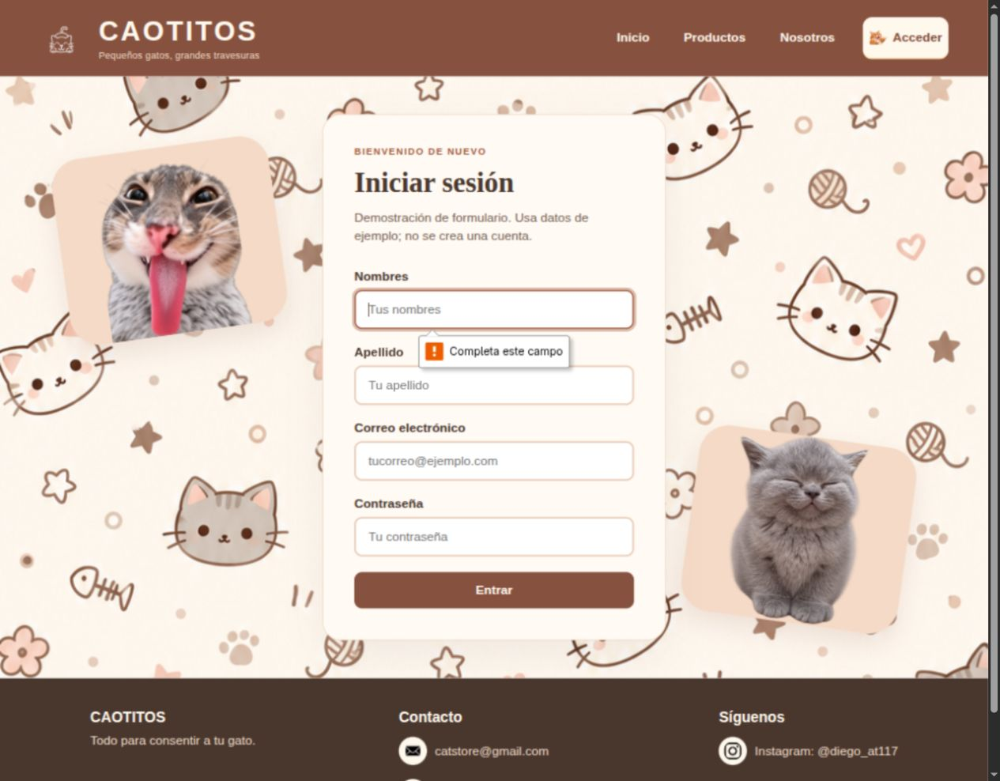

**9. Formulario completado:** respuesta con datos de ejemplo y contraseña vacía.
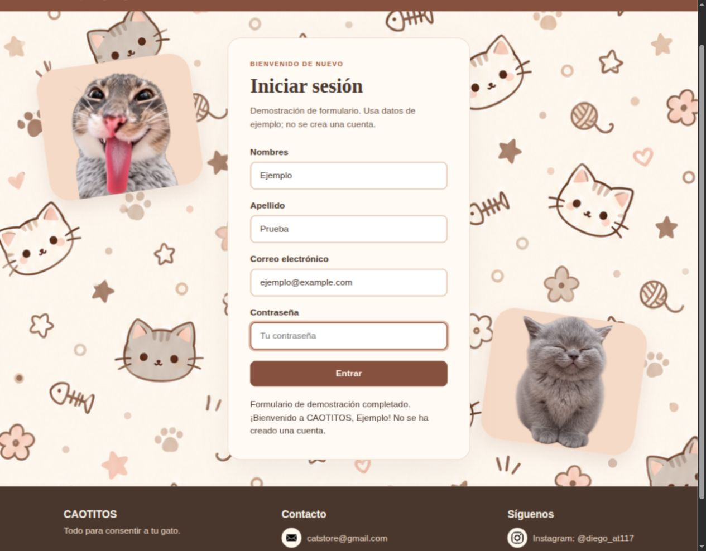

**10. Inicio y encabezado móvil:** marca compacta y cuatro enlaces visibles.
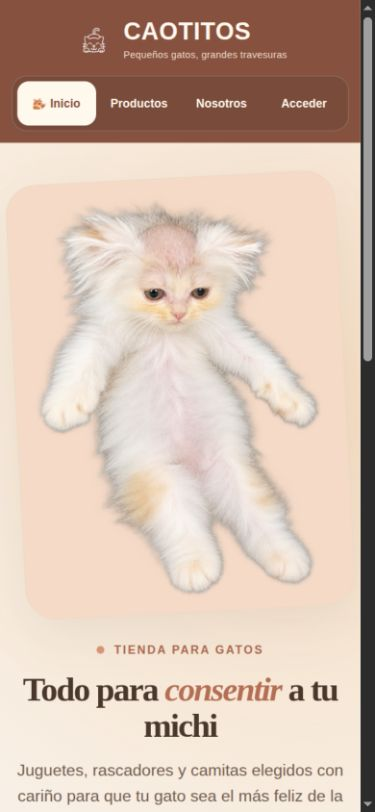

**11. Catálogo móvil:** presentación reorganizada para teléfono.
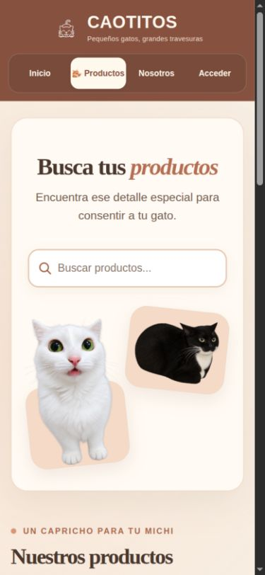

**12. Formulario móvil:** campos y botón adaptados al ancho disponible.
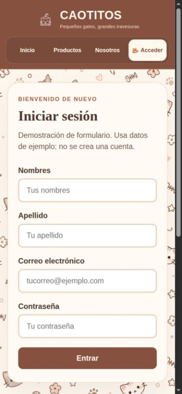

**13. Producción en Vercel:** la dirección pública ya muestra CAOTITOS.
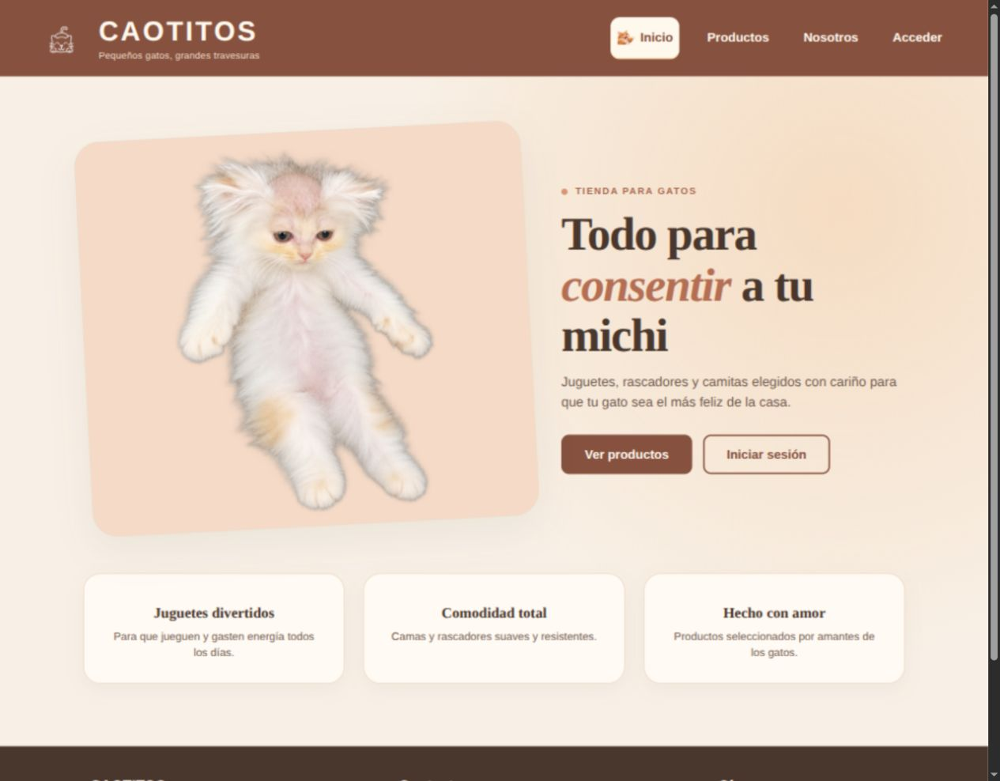

## 11. Ejecución, Git y despliegue

Desde la carpeta del proyecto:

```bash
python3 -m http.server 8765 --bind 127.0.0.1
```

Abrir `http://127.0.0.1:8765/`. Para verificar el código:

```bash
python3 scripts/verificar.py
node --check JS/script.js
node --check JS/login.js
```

El repositorio de publicación es [ARIOT117/CATSTORE](https://github.com/ARIOT117/CATSTORE), independiente de INGENERIA, y su rama principal es `main`. La entrega utiliza el mensaje de commit **resultado funal unidad 2**. El historial y los archivos de licencia del repositorio independiente se conservan.

El proyecto de hosting es [ariot1/catstore en Vercel](https://vercel.com/ariot1/catstore). Su dirección pública es [catstore-puce.vercel.app](https://catstore-puce.vercel.app). El estado de GitHub confirma que existe integración con Vercel. La raíz de publicación es la raíz del repositorio CATSTORE, donde está `index.html`; no una carpeta de INGENERIA. El sitio es estático y no necesita compilación.

**Verificación del hosting:** el commit de entrega `8c0dd00` obtuvo estado `success` de Vercel, con la descripción «Deployment has completed». Se abrió la URL pública y se comprobó el título, la marca CAOTITOS y la carga de imágenes. La marca del sitio cambió; el nombre técnico del repositorio y la URL de Vercel se conservaron para mantener los enlaces existentes.

## 12. Optimización de imágenes

Se midieron los archivos usados antes de modificar el sitio. Las 14 imágenes en uso sumaban **20,05 MiB**. Los iconos de solo 36 píxeles en pantalla medían 1254 × 1254 píxeles y cada uno ocupaba cientos de KiB; el gato que identifica la página activa superaba los 2 MiB.

Se redujeron las dimensiones a las necesarias para su presentación, se conservaron las transparencias y se codificaron en WebP. El logo y los iconos usan compresión sin pérdida; los demás recursos usan calidad 80. Las 14 imágenes nuevas suman **0,75 MiB**, una reducción del **96,3 %** en los archivos de imagen que usa la web. La carga real también depende de la conexión y de la caché del navegador, así que esta cifra representa peso de archivos, no tiempo de carga medido.

| Recurso | Antes | Después |
|---|---:|---:|
| Logo | 260 KiB | 5 KiB |
| Gato de navegación | 2152 KiB | 4 KiB |
| Imagen principal de Inicio | 2041 KiB | 149 KiB |
| Patrón del formulario | 1486 KiB | 82 KiB |
| Rascador del catálogo | 1966 KiB | 84 KiB |
| Todas las 14 imágenes usadas | 20,05 MiB | 0,75 MiB |

Se actualizaron las referencias de HTML, CSS y JavaScript. El gato principal de Inicio tiene `fetchpriority="high"` para favorecer su carga y las fotos del catálogo conservan `loading="lazy"`. Los cinco recursos sin uso en `archivo/` no afectan el peso descargado por las páginas.

Después de la conversión se abrieron las cuatro páginas en anchos de 1280 y 390 píxeles: todas las imágenes cargaron y ninguna página presentó desbordamiento horizontal. La revisión visual confirmó que el logo, el gato principal y el patrón mantienen un aspecto adecuado. Las imágenes anteriores siguen en el historial de Git para una posible restauración.

## 13. Limitaciones y mejoras futuras

- El formulario no autentica usuarios y no debe recibir credenciales reales.
- Los productos y existencias son datos de demostración, no un inventario sincronizado.
- No existen carrito, pedidos ni pagos.
- No se comprobó la procedencia ni licencia de los recursos originales.
- Los cinco recursos del archivo siguen en su formato original, pero no se cargan en las páginas. Si se reutilizan, deben optimizarse antes de publicarlos.
- La navegación compartida se mantiene en cuatro HTML: el verificador detecta divergencias, pero no las corrige automáticamente.
- Se puede ampliar la búsqueda para ignorar acentos y añadir filtros por categoría.
- La información de portada debe completarse con los datos académicos reales.

## 14. Conclusiones y procedencia

La entrega integra cuatro páginas con navegación coherente, un catálogo dinámico y un formulario demostrativo. La revisión eliminó la diferencia de enlaces entre pies de página y dejó una organización de imágenes que permite localizar los recursos por su función. El encabezado móvil conserva todos los destinos en una barra visible y se comprobó sin desbordamiento en anchos de 320 y 390 píxeles.

El proyecto permite demostrar el uso de HTML semántico, estilos compartidos, eventos, arreglos, filtros, actualización del DOM y optimización de recursos para la web. La documentación distingue entre las funciones que realmente existen y las mejoras pendientes, para que el reporte sea verificable a partir de los archivos entregados.

**Fuentes de evidencia:** los cuatro HTML, `CSS/style.css`, `JS/script.js`, `JS/login.js`, el verificador y las capturas incluidas. Los recursos gráficos provienen de la carpeta original del proyecto; no se inventa autoría, licencia ni herramienta de origen. La revisión, organización y documentación de esta entrega se realizaron con asistencia de Codex. Los datos académicos personales no fueron proporcionados.
